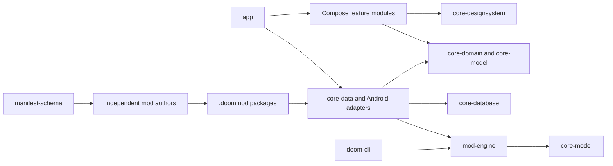

# DOOM phase 1

## ADR 1 — Declarative packages

The host recognizes versioned trigger and effect identifiers. Packages are data with bounded size and a closed set of fields. The JVM engine is shared by the Android app and the author CLI.

## Milestone 1 ADR 2 — Installation and runtime

Room owns installed metadata, desired enabled state, settings, grants and execution history. Runtime activity is process-local and starts inactive. Installation stages privately, commits the validated package before publishing its Room row, and sweeps unpublished files before the first import in a process. The checked-in Room schema is the version 1 baseline. Earlier unpublished scaffolds can be reset by clearing app data. Add explicit migrations for changes after this baseline.

## Milestone 1 ADR 3 — Overlay lifetime

For Phase 1, overlays are scoped to a resumed DOOM activity and a charging battery. The renderer removes windows on pause. Each mod requires a user grant and Android special app access. The in-app preview uses the same visual settings and works without Android overlay access. Background execution is outside the selected lifecycle. Physical-device testing is required to verify system behavior.

## ADR 4 - Durable readiness

Milestone 2 moves the library to Room v2 with a non-destructive migration and an explicit lifecycle state machine. DataStore owns global safe mode, theme and diagnostic logging. Startup reconciliation checks capability and compatibility again before returning a persisted readiness state. The app navigation registers a bundled development sample. Activation and import entry points are outside the milestone. See the [Milestone 2 report](MILESTONE_2.md).

## ADR 5 - Review before publishing

Discover uses Android's document picker and a dedicated import ViewModel. The coordinator stages the content URI, validates its container, manifests and images, and presents an unverified review. The existing repository owns the install journal, Room commit and recovery. Schema v3 adds package hash, declared capabilities, author, license and setting bounds with an additive migration. The app stops at readiness. See [package security](PACKAGE_SECURITY.md) and [the wire format](MOD_FORMAT.md).

## ADR 6 - Foreground runtime over verified packages

The Android adapter observes Room readiness and DataStore safe mode. It feeds validated package plans into a serialized, foreground-only runtime. The runtime routes allowlisted events to native effect actions, rechecks capability and permission gates, and owns cleanup handles for native windows and previews. Session state is published separately from the persisted lifecycle so a process restart starts without active effects. See [Milestone 4](MILESTONE_4.md).

## ADR 7 - Alpha recovery and configurable rings

Ring options are public definition v2 settings. Both the bundled and user-selected Battery Glow archives land in private package storage through the journaled installer. Room v4 retains validated ring defaults so Reset Mod Settings can restore them without rolling back package versions. Runtime recovery distinguishes system-reported startup failures from routine process death. The runtime rehashes installed bytes before using a cached definition and tracks live resources only within the foreground session. See [Milestone 5](MILESTONE_5.md).

## SDK API 2 decisions

See [Milestone 6 audit](MILESTONE_6_AUDIT.md) for the existing module graph responsibilities and API 2 decisions. Public schemas route explicit version tuples to the same secure importer and runtime. A shipped metadata registry describes standard capability requirements. DeviceCapabilityScanner supplies observed API probes for compatibility and exported diagnostics. Developer-defined integer options use existing Room settings plus additive schema migration 4 to 5. Future privileged transports remain design-only behind a proposed permission broker.
