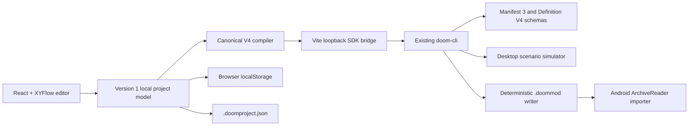

# Visual Builder Architecture

The project format stores builder identity, metadata, definition settings, trigger trees and canvas positions. It is separate from package files. Compilation emits only the existing manifest and V4 definition fields. The Vite middleware accepts bounded JSON, writes the two package files and an optional scenario to an OS temporary directory, then invokes the CLI as a child process. It binds only to `127.0.0.1`; package validation and ZIP creation are not reimplemented in the UI. Temporary source and archive files are removed after each operation.

The compiler preserves action array order. V4 currently models one condition expression per trigger, with recursive ALL/ANY children, and settings references only in supported action parameters. The canvas connection type guard rejects backwards, cross-trigger and same-node links. Capability selections declare package requirements; they never approve those requirements.

Production static output is a UI build. Complete validation, simulation and package export are served through the local Vite bridge during `npm run dev`. The Android application ID and Android runtime are unchanged.
