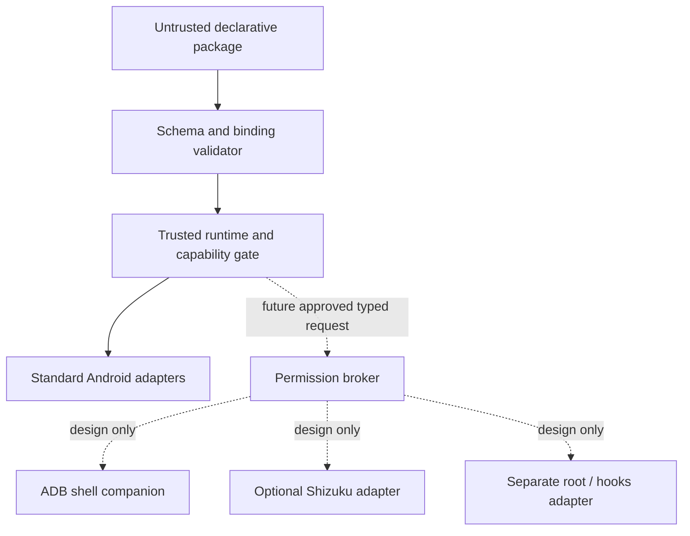

# Privilege architecture (design)

Milestone 6 implements the STANDARD tier only. ADB companion, Shizuku and root adapters are design proposals with no operational bridge or privileged command endpoint in this release. A richer developer workflow does not confer additional OS privileges.

A future broker accepts a versioned typed operation, scope, target, bounded parameters, requester identity and expiry. It verifies an allowlisted operation, actual adapter identity, device support, fresh explicit approval and safe-mode state. A request cannot carry a shell string, script, executable path, arbitrary intent or downloaded class. Unknown operation IDs fail closed. Standard packages cannot acquire a privileged tier by naming it in their manifest.

ADB shell is not root. Availability would depend on the actual shell identity, grants, OEM policy, OS release and connection lifetime. Shizuku would be an optional transport with separate approval and disconnect recovery. Root/hooks would use a separate privileged component and compatibility policy. None may silently fall back to a stronger identity.

Require authenticated caller UID/signature checks, non-exported endpoints where possible, protocol negotiation, scoped capability tokens bound to a package digest/session, expiry, replay protection, bounded queues and auditable operation results. Disconnect/revocation cancels pending requests and releases resources. Audit records must not include secrets. Any setting/package mutation needs a narrowly specified rollback snapshot where restoration can be verified. A generic arbitrary-command API is outside this design.

Future work requires threat modeling and device tests for every operation. No ADB settings writes, package management, LSPosed hooks or root installation are implemented here.
